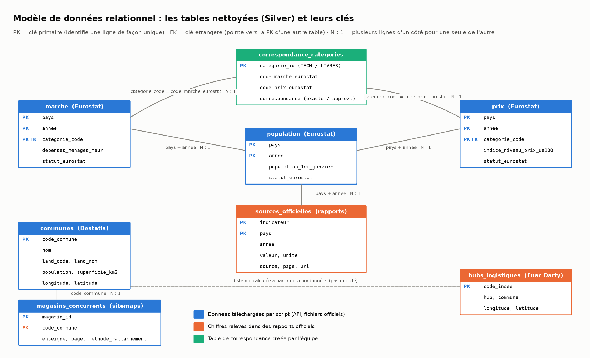
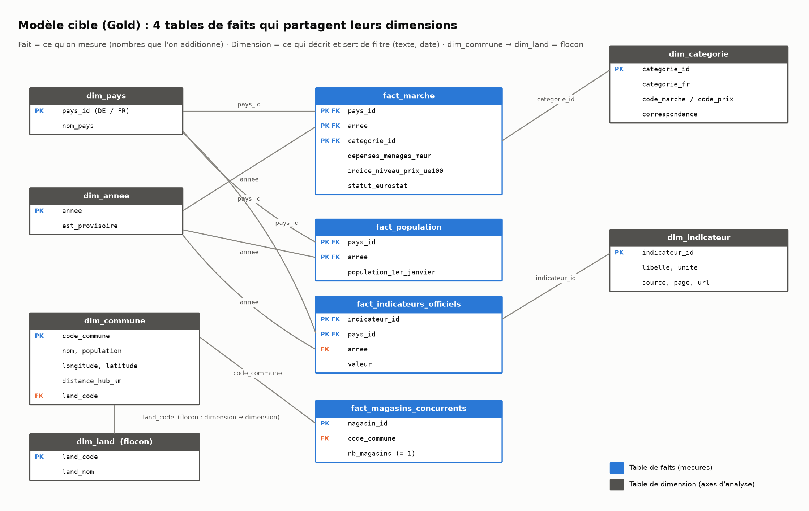

# Fnac en Allemagne : implantation réalisable et rentable ?

Projet final du cours Data Analytics (Eugenia School, M2). Le Comex de la Fnac étudie, dans sa stratégie 2027-2029, une implantation dans un pays européen hors France. Ce repo collecte, structure et analyse les données nécessaires pour répondre à une seule question :

> **L'implantation de la Fnac en Allemagne est-elle réalisable et rentable ?**

---

## 1. Présentation de l'entreprise

**La Fnac** est une enseigne du groupe **Fnac Darty**, coté à la Bourse de Paris. Le groupe se présente comme un « leader européen de la distribution de biens culturels, de loisirs, de produits techniques, d'électroménager et de services ». En 2024, il a réalisé près de 8 milliards d'euros de chiffre d'affaires, avec environ 25 000 collaborateurs. Les ventes en ligne représentent 22 % de ce chiffre d'affaires. *(DEU 2024, p. 18)*

**Périmètre retenu : l'enseigne Fnac seule.** Darty (électroménager) et Nature & Découvertes sont exclus de l'étude.

| Élément | Valeur | Source |
|---|---|---|
| Activité en France | Distribution omnicanale (magasins et fnac.com) de biens culturels et de produits techniques | DEU 2024, p. 18 |
| **Nombre de magasins Fnac en France (X)** | **205** à fin 2025 | DEU 2025, p. 39 *(voir l'encadré ci-dessous)* |
| Évolution du réseau français en 2025 | 1 ouverture, 15 fermetures | DEU 2025, p. 39 |
| Catalogue produits | Biens culturels et de loisirs (dont jeux et jouets depuis 2011), produits techniques, services | DEU 2024, p. 18 et 27 |
| Pays où la Fnac est déjà présente en Europe | France, Belgique, Luxembourg, Suisse, Espagne, Portugal | Site Fnac Darty, « Fnac Darty around the world » |
| **Pays ciblé** | **Allemagne** | voir ci-dessous |

> **Pourquoi 205 et pas 219 ?** Le DEU 2025 indique « 317 magasins au total, parmi lesquels 219 magasins situés en France ». Sa note de bas de page précise que ces 219 incluent 14 magasins à l'étranger (Tunisie, Qatar, Sénégal, Côte d'Ivoire, Congo, Cameroun, Arabie saoudite). Les magasins réellement situés en France sont donc 219 − 14 = **205**.

**Pourquoi l'Allemagne ?**
- C'est le premier marché d'Europe par sa population : 83,6 millions d'habitants contre 68,9 millions en France au 1er janvier 2025 (Eurostat, `demo_pjan`).
- Le groupe Fnac Darty n'y est pas présent.
- Son leader, MediaMarkt/Saturn, est le concurrent direct de la Fnac sur les produits techniques.

### Équipe

| Prénom | Nom |
|---|---|
| Romane | LONG |
| Elena | KERVENNIC |
| Arquam | EL MEZOUARI EL GLAOUI |
| Samantha | ASDRUBAL |

---

## 2. Cadrage & dictionnaire de données

**Question du Comex :** l'implantation de la Fnac en Allemagne est-elle réalisable et rentable ?
**Périmètre :** enseigne Fnac (biens culturels et produits techniques), Allemagne comparée à la France, de 2015 à 2025 selon les sources.

### 2.1 Métriques (KPI)

Un KPI par question du guide fourni par le Comex, et un KPI de synthèse qui répond à « rentable ? ».

| Axe | KPI | Formule | Données utilisées | Ce qu'il permet de décider |
|---|---|---|---|---|
| Marché & potentiel | **Taux de croissance annuel du secteur** | (dépenses des ménages N / dépenses N-1) − 1, par catégorie et par pays | `fact_marche` | Le marché allemand grandit-il ? |
| Marché & potentiel | **Part de marché de Fnac Darty en France** *(estimation)* | CA France × (part produits techniques + part produits éditoriaux) / dépenses FR (TECH + LIVRES) | `fact_indicateurs_officiels`, `fact_marche` | Quelle part la Fnac sait-elle prendre sur son marché d'origine ? |
| Marché & potentiel | **Part de marché du concurrent en Allemagne** *(fourchette)* | basse : ventes CECONOMY DE × part « IT et mobile » / dépenses DE TECH ; haute : ventes CECONOMY DE / dépenses DE TECH | `fact_indicateurs_officiels`, `fact_marche` | Le marché est-il déjà verrouillé ? |
| Prix & marges | **Indice de prix relatif DE / FR** | indice de niveau des prix DE / indice FR × 100 (TTC), puis hors taxes : (indice DE / (1 + TVA DE)) / (indice FR / (1 + TVA FR)) × 100 | `fact_marche`, `fact_indicateurs_officiels` | Les prix allemands permettent-ils le positionnement de la Fnac ? |
| Prix & marges | **Marge brute estimée post-taxe** | 1 − (1 − taux de marge brute du groupe) / (indice relatif hors taxes / 100), à coût d'achat identique | idem | La marge reste-t-elle suffisante au prix allemand ? |
| Réseau & implantation | **Densité concurrentielle par zone de chalandise** | magasins CECONOMY du Land / population du Land × 1 000 000 | `fact_magasins_concurrents`, `dim_commune`, `dim_land` | Dans quels Länder ouvrir en premier ? |
| Réseau & implantation | **Coût moyen au m² commercial** *(hypothèse)* | loyer de référence × surface type d'un magasin | hypothèse documentée (§ 3) | Quel coût pour chaque ouverture ? |
| Opérations & logistique | **Distance moyenne depuis le hub** | distance à vol d'oiseau (formule de haversine) entre le hub et chaque ville de 100 000 habitants ou plus, moyenne pondérée par la population | `dim_commune`, hub | Livrer depuis la France, ou ouvrir un entrepôt en Allemagne ? |
| Opérations & logistique | **Droits de douane / taxes locales** | droits de douane entre pays de l'UE ; écart de TVA DE − FR | `fact_indicateurs_officiels` | Surcoût réglementaire du passage de frontière |
| Assortiment | **Taux de pénétration des catégories** | (dépenses DE / population DE) / (dépenses FR / population FR) × 100, par catégorie | `fact_marche`, `fact_population` | Quelles catégories vendre en priorité ? |
| Assortiment | **% du catalogue France éligible** *(simulé)* | part des références du catalogue vendables en Allemagne | données simulées, signalées comme telles | 100 % du catalogue ou un assortiment ciblé ? |
| Synthèse | **Délai de retour sur investissement d'un magasin** | investissement d'ouverture / résultat annuel estimé d'un magasin | KPI ci-dessus | Go / No-Go |

### 2.2 Dimensions (axes d'analyse)

| Dimension | Clé | Valeurs | Usage |
|---|---|---|---|
| `dim_pays` | `pays_id` | DE, FR, GROUPE | Comparer l'Allemagne à la France ; GROUPE pour les chiffres publiés au niveau d'un groupe entier |
| `dim_annee` | `annee` | 2015 → 2026 | Suivre une évolution, calculer une croissance |
| `dim_categorie` | `categorie_id` | TECH, LIVRES | Séparer les deux métiers de la Fnac |
| `dim_commune` | `code_commune` | 10 753 communes allemandes | Localiser les concurrents, mesurer les distances |
| `dim_land` | `land_code` | 16 Länder | Zone de chalandise à l'échelle régionale (flocon de `dim_commune`) |
| `dim_indicateur` | `indicateur_id` | 20 indicateurs relevés dans les rapports | Tracer la source et la page de chaque chiffre |

### 2.3 Règles de gestion

1. **Une source par sujet.** Si deux sources donnent un chiffre pour la même chose, on n'en garde qu'une, pour ne jamais afficher deux valeurs différentes.
2. **Une année commune.** Une date (« 2025-12-31 ») donne son année. Un exercice décalé (« 2024/25 ») est rattaché à son **année de clôture** (2025). Un taux en vigueur est daté de l'année de consultation.
3. **Valeurs provisoires gardées.** Eurostat marque certaines valeurs « provisoire ». On les garde, avec la mention dans `statut_eurostat`, et on le signale dans les visuels.
4. **Zones sans habitants exclues.** 200 « communes » sans habitants (forêts, lacs, eaux côtières) sont retirées : on ne peut pas y ouvrir de magasin.
5. **Un seul concurrent.** MediaMarkt et Saturn appartiennent à CECONOMY : ils forment **un** concurrent. Un magasin listé sur les deux sites (même identifiant) est compté une fois.
6. **Rattachement magasin → commune**, du plus sûr au moins sûr : table manuelle, puis nom exact, puis début du nom officiel. Un mot générique seul (« Bad », « Sankt ») ne suffit jamais. La méthode utilisée est gardée dans `methode_rattachement`.
7. **Chiffre de groupe.** Un chiffre publié pour un groupe entier (CECONOMY, Fnac Darty) porte le pays `GROUPE`. Une clé n'est jamais vide.
8. **Correspondance des catégories.** TECH a la même définition dans le marché et dans les prix (`exacte`). LIVRES n'a pas d'indice de prix propre : on utilise celui des loisirs et de la culture (`approximative`).
9. **Prix comparés hors taxes.** Les indices de prix Eurostat incluent la TVA. Pour estimer une marge, on retire la TVA de chaque pays.
10. **Hypothèses et données simulées signalées.** Toute valeur qui ne vient pas d'une source officielle est marquée « hypothèse » ou « simulé ».

### 2.4 Termes métier

| Terme | Définition |
|---|---|
| **Zone de chalandise** (« zone d'achalandage ») | Territoire d'où vient la clientèle d'un magasin. Ici, approché par le Land. |
| **Indice de niveau des prix** (PLI) | Prix d'un panier de produits dans un pays, comparé à la moyenne de l'UE (= 100). Au-dessus de 100, le pays est plus cher. |
| **COICOP** | Nomenclature internationale qui classe les dépenses des ménages par fonction (ex. 08.1 = équipements d'information et de communication). Version 2018 utilisée. |
| **Dépenses de consommation des ménages** | Ce que les ménages d'un pays dépensent dans une catégorie : la taille du marché. |
| **Part de marché** | Ventes d'une entreprise / taille totale du marché. |
| **Taux de marge brute** | (Chiffre d'affaires − coût d'achat des produits vendus) / chiffre d'affaires. |
| **TVA** | Taxe sur la valeur ajoutée, incluse dans le prix payé par le client et reversée à l'État. Taux normal : 19 % en Allemagne, 20 % en France. |
| **Union douanière** | Les marchandises circulent entre pays de l'UE sans droits de douane. |
| **Taux de pénétration** | Dépense par habitant dans une catégorie, comparée à un pays de référence. |
| **Prix unique du livre** | En Allemagne (Buchpreisbindungsgesetz) comme en France (loi Lang), l'éditeur fixe le prix de vente du livre : un libraire ne peut pas le casser. |
| **Exercice décalé** | Année comptable qui ne suit pas l'année civile. CECONOMY clôture au 30 septembre. |
| **Hub logistique** | Entrepôt d'où partent les produits vers les magasins et les clients. |

### 2.5 Dictionnaire des données

Format du cours : Champ / Type de donnée / Description / Formule / Exemple / Source. Les exemples sont de vraies valeurs des tables Silver.

**`marche`**, dépenses des ménages par pays, année et catégorie (44 lignes)

| Champ | Type de donnée | Description | Formule | Exemple | Source |
|---|---|---|---|---|---|
| `pays` | Texte (clé) | Code pays ISO à 2 lettres | NA | FR | Eurostat `nama_10_cp18` |
| `annee` | Entier (clé) | Année civile | NA | 2025 | idem |
| `categorie_code` | Texte (clé) | Code COICOP 2018 de la catégorie | NA | CP097 | idem |
| `categorie` | Texte | Libellé Eurostat de la catégorie | NA | Newspapers, books and stationery | idem |
| `depenses_menages_meur` | Numérique | Dépenses de consommation des ménages, en millions d'euros courants | NA | 10 674,7 | idem |
| `statut_eurostat` | Texte | Avertissement Eurostat (vide si valeur définitive) | NA | provisoire | idem |

**`prix`**, indices de niveau des prix (16 lignes)

| Champ | Type de donnée | Description | Formule | Exemple | Source |
|---|---|---|---|---|---|
| `pays`, `annee` | Texte, entier (clé) | Pays et année | NA | FR, 2025 | Eurostat `prc_ppp_ind_1` |
| `categorie_code` | Texte (clé) | Catégorie de l'indice (A010801 = même périmètre que CP081) | NA | A0109 | idem |
| `categorie` | Texte | Libellé Eurostat | NA | Recreation, sport and culture | idem |
| `indice_niveau_prix_ue100` | Numérique | Niveau des prix TTC, moyenne UE = 100 | prix du pays / prix moyen UE × 100 | 102,5 | idem |
| `statut_eurostat` | Texte | Avertissement Eurostat | NA | (vide) | idem |

**`population`**, population au 1er janvier (22 lignes)

| Champ | Type de donnée | Description | Formule | Exemple | Source |
|---|---|---|---|---|---|
| `pays`, `annee` | Texte, entier (clé) | Pays et année | NA | FR, 2025 | Eurostat `demo_pjan` |
| `population_1er_janvier` | Entier | Nombre d'habitants au 1er janvier | NA | 68 882 600 | idem |
| `statut_eurostat` | Texte | Avertissement Eurostat | NA | provisoire | idem |

**`communes`**, communes allemandes habitées (10 753 lignes)

| Champ | Type de donnée | Description | Formule | Exemple | Source |
|---|---|---|---|---|---|
| `code_commune` | Texte (clé) | Code officiel de la commune (AGS, 8 chiffres) | Land + district + arrondissement + commune | 01001000 | Destatis, Gemeindeverzeichnis 31.12.2025 |
| `nom` | Texte | Nom officiel | NA | Flensburg, Stadt | idem |
| `land_code` | Texte (clé étrangère) | Code du Land | NA | 01 | idem |
| `land_nom` | Texte | Nom du Land | NA | Schleswig-Holstein | idem |
| `population` | Entier | Habitants au 31/12/2025 (base recensement 2022) | NA | 95 568 | idem |
| `superficie_km2` | Numérique | Superficie | NA | 56,73 | idem |
| `longitude`, `latitude` | Numérique | Coordonnées du centre de la commune (degrés) | virgule décimale convertie en point | 9,43751 / 54,78252 | idem |

**`magasins_concurrents`**, magasins MediaMarkt et Saturn en Allemagne (394 lignes)

| Champ | Type de donnée | Description | Formule | Exemple | Source |
|---|---|---|---|---|---|
| `magasin_id` | Entier (clé) | Identifiant du magasin, commun aux deux sites | nombre en fin d'adresse de la page | 201 | Plans de site mediamarkt.de / saturn.de |
| `enseigne` | Texte | Site où le magasin a été trouvé en premier | NA | mediamarkt | idem |
| `page` | Texte | Nom de la page du magasin | NA | Erlangen-201 | idem |
| `nom_page` | Texte | Nom de ville extrait et normalisé | minuscules, ü → ue, préfixes retirés | erlangen | calculé |
| `methode_rattachement` | Texte | Comment le magasin a été relié à sa commune | règle de gestion n° 6 | nom exact | calculé |
| `liste_sur_les_deux_sites` | Booléen | Le magasin apparaît chez MediaMarkt et chez Saturn | NA | False | calculé |
| `code_commune` | Texte (clé étrangère) | Commune du magasin | jointure sur le nom normalisé | 09562000 | Destatis |
| `commune`, `land_code`, `land_nom`, `longitude`, `latitude` | Texte, numérique | Attributs de la commune rattachée | NA | Erlangen, 09, Bayern | Destatis |

**`sources_officielles`**, chiffres relevés dans des documents officiels (20 lignes)

| Champ | Type de donnée | Description | Formule | Exemple | Source |
|---|---|---|---|---|---|
| `indicateur` | Texte (clé) | Nom de l'indicateur | NA | fnac_magasins_total | relevé par l'équipe |
| `pays` | Texte (clé) | Pays concerné ; vide = chiffre de groupe (GROUPE dans le Gold) | NA | (vide) | idem |
| `valeur` | Numérique | Valeur publiée | NA | 317 | document cité |
| `unite` | Texte | Unité de la valeur | NA | magasins | idem |
| `periode` | Texte | Période telle qu'écrite dans le document | NA | 2025-12-31 | idem |
| `annee` | Entier | Année de rattachement | règle de gestion n° 2 | 2025 | calculé |
| `source`, `page`, `url` | Texte | Document, page et lien officiel | NA | Fnac Darty - DEU 2025, p. 39 | idem |

**`hubs_logistiques`** (1 ligne) : `hub`, `commune`, `code_insee` (clé), `longitude`, `latitude`, `statut`, `source`, `url`. Exemple : Plateforme Fnac Darty Chilly-Mazarin, 91161, 2,3103 / 48,7051. Source : communiqué Fnac Darty et API Découpage administratif (geo.api.gouv.fr).

**`correspondance_categories`** (2 lignes) : `categorie_id` (clé), `categorie_fr`, `code_marche_eurostat`, `code_prix_eurostat`, `correspondance` (exacte / approximative), `commentaire`. Exemple : TECH, CP081, A010801, exacte. Table créée par l'équipe (règle de gestion n° 8).

### 2.6 Modèle de données

**Modèle relationnel** (tables Silver et leurs clés) :



**Modèle cible** (Gold) : quatre tables de faits de grains différents, qui partagent leurs dimensions (constellation), avec un flocon `dim_commune → dim_land` :



## 3. Architecture & choix des sources

*À venir : une source fiable par sujet, avec la justification de chacune.*

```
data/manual/   Chiffres relevés à la main dans des documents officiels (source + page)
data/raw/      Bronze : données téléchargées par les scripts, jamais modifiées
data/silver/   Silver : données nettoyées, un fichier par source
data/gold/     Gold   : modèle en étoile + KPI
src/collect/   Un script de téléchargement par source
src/clean/     Un script de nettoyage par source
docs/          Livrables : dashboard, slides, images
```

Les données Bronze et Silver sont versionnées : le dépôt garde une copie figée de ce qui a été téléchargé, même si la source est mise à jour ensuite. Eurostat a, par exemple, publié une révision le 10/11/2026. Pour tout régénérer : `python run_pipeline.py`.

**Licences des données réutilisées**
- Eurostat : © Union européenne, 1995-2026, licence [CC BY 4.0](https://ec.europa.eu/eurostat/help/copyright-notice). Données transformées par l'équipe : dépliage du format JSON-stat et sélection DE / FR.
- Statistisches Bundesamt (Destatis), *Gemeindeverzeichnis 31.12.2025*, licence [dl-de/by-2-0](https://www.govdata.de/dl-de/by-2-0). Données transformées par l'équipe : sélection des communes, conversion des coordonnées, retrait des zones sans habitants.

## 4. Plan d'organisation & roadmap

*À venir.*

## 5. Stack technique

*À venir.*

---

## Sources citées

- **DEU 2024** : Fnac Darty, *Document d'enregistrement universel 2024*. https://fnacdarty.com/wp-content/uploads/2025/03/fnac-darty-deu-2024-assemblage-mel-opti.pdf
- **DEU 2025** : Fnac Darty, *Document d'enregistrement universel 2025*, déposé à l'AMF le 06/03/2026. https://www.fnacdarty.com/wp-content/uploads/2026/03/fnac-darty-deu-2025-assemblage-pdf-opti-1.pdf
- **Fnac Darty around the world** : https://www.fnacdarty.com/en/group/fnac-darty-around-the-world/
- **Eurostat `demo_pjan`** : population au 1er janvier. https://ec.europa.eu/eurostat/databrowser/view/demo_pjan/default/table
